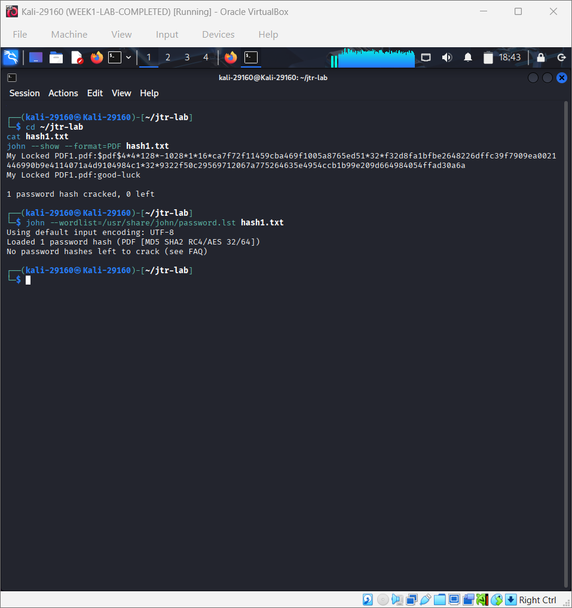
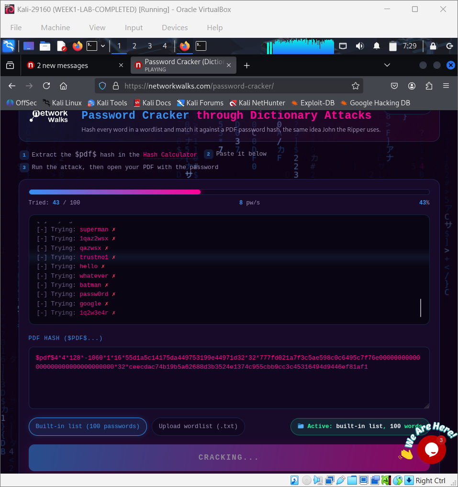
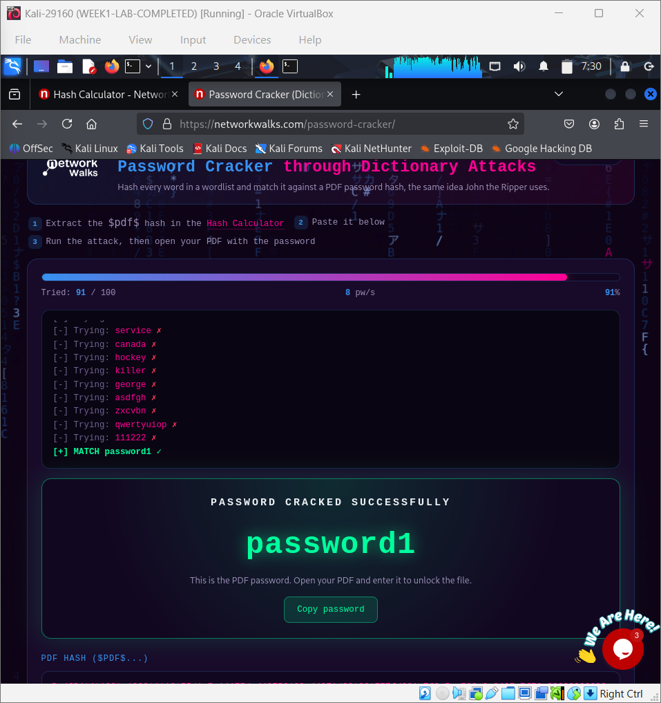

# Week 3 Project – Password Cracking with JTR & Networkwalks Tools

Cybersecurity & Ethical Hacking internship project (Networkwalks Academy).
Goal: recover the password of a locked PDF file using two different methods.

## Environment

- **OS:** Kali Linux (running as a VirtualBox VM, host: Windows)
- **Target file:** `My Locked PDF1.pdf` (PM1) / `My Locked PDF1 (for NW Tools Lab WK3-PM2).pdf` (PM2)
- **Tools used:**
  - PM1 – John the Ripper (`pdf2john.pl`, `john`)
  - PM2 – Networkwalks Hash Calculator & Password Cracker (web tools)

---

## PM1 – Password Cracking with John the Ripper (JTR)

### Steps

1. Shared a VirtualBox folder (`sf_Week_3_Files`) containing the lab PDFs with the Kali VM, then copied the target file into a working directory:
   ```bash
   mkdir -p ~/jtr-lab
   cp "/media/sf_Week_3_Files/My Locked PDF1.pdf" ~/jtr-lab/
   cd ~/jtr-lab
   ```
2. Extracted a crackable hash from the PDF using John's bundled `pdf2john.pl`:
   ```bash
   perl /usr/share/john/pdf2john.pl "My Locked PDF1.pdf" > hash1.txt
   cat hash1.txt
   ```
   ```
   My Locked PDF1.pdf:$pdf$4*4*128*-1028*1*16*ca7f72f11459cba469f1005a8765ed51*32*f32d8fa1bfbe2648226dffc39f7909ea0021446990b9e4114071a4d9104984c1*32*9322f50c29569712067a775264635e4954ccb1b99e209d664984054ffad30a6a
   ```
3. Ran John the Ripper against the extracted hash:
   ```bash
   john hash1.txt
   john --show --format=PDF hash1.txt
   ```
4. John cracked the hash immediately using its default mode and built-in wordlist (`password.lst`) — no need for `rockyou.txt`.

### Result

| File | Cracked password | Flag |
|---|---|---|
| My Locked PDF1.pdf | `good-luck` | `nw{cybersecurity_flag_captured_2608}` |



Opened the PDF in a viewer and confirmed the password unlocked it, revealing the first capture-the-flag reward.


---

## PM2 – Password Cracking with Networkwalks Hash Calculator & Password Cracker

### Steps

1. Opened the Networkwalks Hash Calculator in Firefox (inside Kali):
   `https://networkwalks.com/hash-calculator/`
2. Uploaded `My Locked PDF1 (for NW Tools Lab WK3-PM2).pdf` on the **PDF** tab — the tool extracted a `$pdf$...` hash in the same format `pdf2john` produces.
3. Copied the full hash and opened the Password Cracker:
   `https://networkwalks.com/password-cracker/`
4. Pasted the hash, kept the built-in 100-password list active, and clicked **Start Cracking**.
5. The tool matched the hash against the dictionary and returned the password.

### Result

| File | Cracked password | Flag |
|---|---|---|
| My Locked PDF1 (for NW Tools Lab WK3-PM2).pdf | `password1` | `nw{networkwalks_flag1_jtr_270521_1}` |




Opened the PDF in a viewer and confirmed the password unlocked it, revealing the second capture-the-flag reward.


---

## Key Takeaways

- Both the offline (JTR) and online (Networkwalks web tool) approaches extract the **same hash format** (`$pdf$...`) from a locked PDF and recover the password via a dictionary/wordlist attack.
- Both cracked passwords (`good-luck`, `password1`) are common, dictionary-guessable passwords and were cracked almost instantly — a clear demonstration of why predictable passwords offer little real protection.
- `pdf2john.pl` and the Networkwalks Hash Calculator both produce hashes compatible with John the Ripper / hashcat, showing that offline and online tooling can be used interchangeably in this type of attack.
- Each module's PDF contained a hidden flag that was only readable after the password was recovered — illustrating how weak passwords directly expose protected content.

---

## Folder structure

```
.
├── README.md
└── screenshots/
    ├── pm1-terminal-hash-and-crack.png
    ├── pm1-pdf1-unlocked-flag.png
    ├── pm2-password-cracker-running.png
    ├── pm2-password-cracker-success.png
    └── pm2-pdf1-unlocked-flag.png
```
